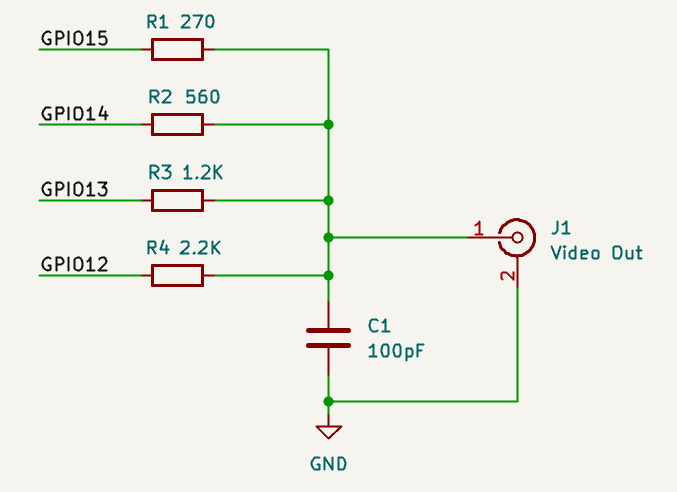
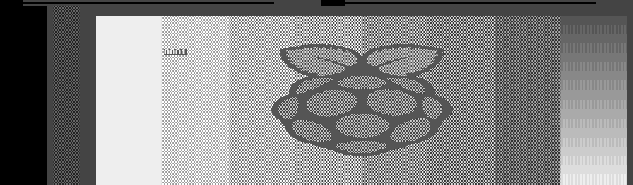

# composite-video-pico
Experiments to generate colour composite video output (NTSC/PAL) from Raspberry Pi Pico.

I've targeted simplicity over high quality or standards compliance, and with little regard for EMC. Some colour and pattern artifacts are to be expected, due to the lack of proper fitlering, and liberties taken with timings.

This is a work in progress, largely undocumented and entirely without warranty. It may be broken from time to time or squashed/rebased without warning.

## Experiment 1: Minimal

Probably the simplest way to generate colour video. The following external hardware is used:

The entire frame, including sync signals and colour bursts, is "painted" into a 4-bit-per-pixel buffer, scanned out by PIO and... that's it.

This simplicity comes at a cost: Only progressive modes (up to 752x240p, 912x288p) are supported. The buffer is huge (115K for NTSC, 168K for PAL), as it must cover all sync pulses as well as the active region. To help with memory alignment and timing, the buffer is arranged as discrete scanlines; the roughly 1 &mu;s gaps between lines are filled with blanking value.

Colours have to be encoded by software, so the sample-rate was chosen to simplify this (14.318 MHz or 17.735 MHz). This in turn requires a specific core clock rate: 157.5 MHz for NTSC or 150.75 MHz for PAL. (Higher rates may be possible, if you want to overclock, but I haven't tried any.)

NTSC is encoded pretty much by-the-book. For PAL, a bodge was needed: I've reduced the effective colour carrier frequency from 4433618.75 Hz to 4433593.75 Hz, a discrepancy of -5.6 ppm (on top of the Pico crystal's &pm; 30 ppm tolerance). This is essential to ensure that a single 312-line field can be repeated exactly.
