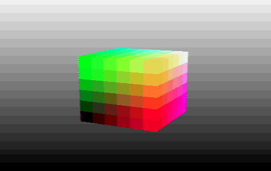

# composite-video-pico
Experiments to generate colour composite video output (NTSC/PAL) from Raspberry Pi Pico.

I've targeted simplicity over high quality or standards compliance, and with little regard for EMC. Some colour and pattern artifacts are to be expected, due to the lack of proper filtering, and liberties taken with timings.

This is a work in progress, largely undocumented and entirely without warranty. It may be broken from time to time or restructured without warning. It _might_ eventually coalesce into a usable library.

## Example 1: [Minimal](minimal)

Probably the simplest way to generate colour video. The following external hardware is used:

The entire frame, including sync signals and colour bursts, is "painted" into a 4-bit-per-pixel buffer, scanned out by PIO and... that's it.

This simplicity comes at a cost: Only progressive modes (up to 752x240p, 912x288p) are supported. The buffer is huge (115K for NTSC, 168K for PAL), as it must cover all sync pulses as well as the active region.

To help with memory alignment and timing, the buffer is arranged as discrete scanlines; the roughly 1 &mu;s gaps between lines are filled with blanking value.

The generated frame buffer looks like this:

Colours have to be encoded by software, so the sample-rate was chosen to simplify this (14.318 MHz or 17.735 MHz). This in turn requires a specific core clock rate: 157.5 MHz for NTSC or 150.75 MHz for PAL. (Higher rates may be possible, if you want to overclock, but I haven't tried any.)

NTSC is encoded pretty much by-the-book. For PAL, a bodge was needed: I've reduced the effective colour carrier frequency from 4433618.75 Hz to 4433593.75 Hz, a discrepancy of -5.6 ppm (on top of the Pico crystal's &pm; 30 ppm tolerance). This is essential to ensure that a single 312-line field can be repeated exactly.

In both the NTSC and PAL standards, single-field output has some fairly bad colour artifacts.

By default this builds for NTSC-M, but can be changed to PAL by editing [CMakeLists.txt](minimal/CMakeLists.txt)

## Example 2: [Framebufferless 3D with interlace and palette](cube)

This example demonstrates the use of a 256-colour palette to simplify software-based colour encoding, based on 4x4-pixel "textures". The chosen palette is a 6x6x6 colour-cube plus 40 grey levels (of which 20 can be distinguished using a spot of dithering).

The colour-cube palette (or at least, its outer faces) is illustrated by a gratuitous 3D animation.

Video is interlaced. All sync pulses and colour bursts are now generated by PIO, assisted by a buffer of short codes (32 bits per sync pulse) to describe sync pulse durations, colour bursts and active lines in a 4-field (for NTSC) or 8-field (for PAL) sequence. The codes occupy 10K bytes.

The PAL version now implements the specified colour frequency, by trickery. Successive colour bursts and active regions start gradually earlier as each field progresses, _shearing_ the picture undetectably. By this means, the colour carrier gains half a cycle per field, yet remains locked to the active region modulo 4 lines, so we can still use the "texture lookup" method to implement colour palettes efficiently.

(PIO can only control timings to core-clock resolution (1/34 colour cycle) causing slight jitter, but PAL was designed to tolerate small phase errors. Since ITU-T BT.470-6 specifies most timings to &pm; 0.1 &mu;s and we are varying sync width and burst start by just &pm; 0.055 &mu;s, it is arguably compliant.)

Colour and texture artifacts are dramatically reduced compared to single-field output, though some remains at coloured edges (due to the lack of band-limiting).

This example is framebufferless -- the 3D scene is rendered piecemeal into a pair of 8-row "stripe buffers". One CPU core is used for everything. By default it builds for PAL-BDGHIK, but can be changed to NTSC-M by editing [CMakeLists.txt](cube/CMakeLists.txt)

## Things maybe to do:

 - Fix up the half-lines (currently they are output as full lines, and in the PAL case impinge on vertical blanking, overriding one equalising pulse)
 - Investigate efficient ways to use different horizontal sample rates, which some emulators might want
 - Investigate efficient ways to filter the chroma components to reduce artifacts
 - Extend to 4-and-a-half bit precision (using a VGA board with G and B shorted together) or 8-bit precision (using a DAC?)
 - Add runtime switching between PAL and NTSC, and between Progressive and Interlaced
 - Investigate NTSC-J, PAL-M, PAL-N
 - Extract useful common code into a library
